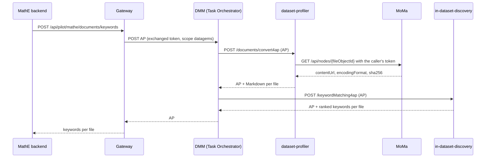

# MathE Document Endpoints

These endpoints convert PDF teaching documents of a DataGEMS dataset to Markdown, for the MathE keywords flow. They are separate from dataset profiling: they convert the files they are asked for, and they may use heavier models than the profiling pipeline.

| Endpoint | Does |
|---|---|
| `POST /documents/convert4ap` | The document conversion operator of an Analytical Pattern (AP): takes the AP, returns it with the Markdown filled in |
| `POST /documents/convert` | The same conversion without an AP, for testing |

The keywords themselves come from in-dataset-discovery's keyword matching, which ranks candidate keywords against this Markdown. The profiler only converts.

## The flow



One request, one response: there is nothing to poll. Each file is converted in its own Ray task, all files at once, and the request waits for them for at most `DOCUMENT_REQUEST_TIMEOUT_SECONDS` (240 s, below DMM's 300 s).

## The Analytical Pattern

The Gateway builds the AP. The profiler reads only its `Document_Convert_Operator` node and the nodes that operator points to:

```text
Analytical_Pattern --consist_of--> Document_Convert_Operator {mode}
Document_Convert_Operator --input-->  cr:FileObject (id only)
Document_Convert_Operator --output--> ResultType {name: "markdown", fileObjectId}
optional: sc:Dataset --distribution--> cr:FileObject
```

- **Reads:** the operator's `mode`, `quality` (default) or `fast`; the ids of its `input` `cr:FileObject` nodes. Any other property of a FileObject node in the AP, a `contentUrl` included, is ignored: the file is the one MoMa names.
- **Dataset:** when the AP has an `sc:Dataset` node (the one distributing the files, or its only one), every file must belong to that dataset.
- **Writes:** on the Markdown `ResultType` node of each file, the `output` of the operator with properties `name: "markdown"` and `fileObjectId`:

| Property | Holds |
|---|---|
| `value` | The Markdown |
| `pages` | Number of pages |
| `model` | The vision model, or `""` in `fast` mode |
| `fallbackPages` | Pages that kept the PDF's text layer after the vision model failed on them |
| `sha256` | Hash of the file's content |
| `error` | Only when that file's conversion failed: why |

Every other node, edge and property is returned exactly as sent, because DMM passes the AP on to in-dataset-discovery. Property names are camelCase, as ap-schemas' `ap-common.schema.json` requires.

A Markdown node, filled:

```json
{
  "id": "e7a4c1b9-3d6f-4e2a-9b5c-1f8d0e6a7b14",
  "labels": ["ResultType"],
  "properties": {
    "name": "markdown",
    "fileObjectId": "5b2d8f17-9c4e-4a63-8d1b-7e0f2a6c9d13",
    "value": "## Worked example 1:\n\nWithout using a calculator, simplify the following:\n\n$$2\\log_{10}(3) + \\log_{10}(16) - 2\\log_{10}\\left(\\frac{6}{5}\\right)$$\n...",
    "pages": 5,
    "model": "glm-5.3-flash",
    "fallbackPages": [],
    "sha256": "cc075a49a8b3a6dbc270b70a7970951d62a9cecbbe36bbf7bc098a4f1b23ba0f"
  }
}
```

The full request example is in the [OpenAPI](openapi.md) page.

## Without an AP

`POST /documents/convert` takes the files directly:

```json
{"fileObjectIds": ["5b2d8f17-9c4e-4a63-8d1b-7e0f2a6c9d13"], "mode": "quality", "datasetId": "0c9b7e65-2f3a-4d18-b6e4-9a1c5d7e8f12"}
```

`datasetId` is optional. The answer lists the files in request order:

```json
{"files": [{"fileObjectId": "5b2d8f17-9c4e-4a63-8d1b-7e0f2a6c9d13", "markdown": "## Worked example 1: ...", "pages": 5,
            "model": "glm-5.3-flash", "fallbackPages": [], "sha256": "cc075a49...", "error": null}]}
```

## Finding the file

The FileObject id is turned into a file here, for now. A generic "FileObject to path" AP operator is planned and will replace this step.

1. The node is read from MoMa, `GET {MOMA_API_URL}/api/nodes/{fileObjectId}`, **with the caller's token**. MoMa answers only if the caller holds `dg_ds-browse` on the file's dataset, and answers 404 otherwise.
2. The node must be a `cr:FileObject` with `encodingFormat` `application/pdf` and a `.pdf` `contentUrl`. Only PDFs are converted.
3. `contentUrl` is mapped to the dataset storage: `s3://X` is `/s3/X`, as for the Gateway, and a mounted path (`/s3/dataset/...`), as profiles store it, is taken as it is. Symlinks are resolved, and the file must lie under `DATA_ROOT_PATH` (`/s3/dataset/`) and, when the dataset is known, in that dataset's folder.
4. The PDF must open and have at most `DOCUMENT_MAX_PAGES` (300) pages.

## Modes

| Mode | How the document is read | Speed | Handles |
|---|---|---|---|
| `quality` (default) | Every page is rendered at 150 DPI and transcribed by a SCAYLE vision model, 4 pages in parallel | 2.5–12 s per page | Scans, handwriting, formulas as LaTeX, figures described in one or two sentences |
| `fast` | The profiler's CPU extraction (PyMuPDF4LLM, Tesseract for scanned pages) | About 1 s per document | Typed text and tables; no handwriting, formulas as plain text |

The default vision model is `glm-5.3-flash`. It was compared with every model SCAYLE served in November 2026, on MathE pages:

- `glm-5.3-flash` was the most faithful. It kept callouts and annotations, and described figures.
- `qwen3.6` was faster (1.4–5.4 s per page) but left out more.
- `kimi-k2.6` spent its whole token budget reasoning and returned nothing.
- The other served models do not accept images.

When the model fails on a page twice, that page keeps the PDF's text layer and is listed in `fallbackPages`. A file fails only when every page failed; it then gets an `error`, and the other files are still returned.

## Cache

Conversions are kept in Redis for `DOCUMENT_CACHE_TTL_SECONDS` (30 days), keyed by the hash of the file's content, the mode and the model: `document_markdown:{sha256}:{mode}:{model}`. A changed file is converted again, and two ids for the same content are converted once.

- Failed conversions are not kept, and neither are conversions with `fallbackPages`: a degraded result must not stay for a month.
- When a request times out (504), its conversions go on and fill the cache, so a retry is answered from it.
- Without Redis, every request converts again.

## Status codes

| Status | When |
|---|---|
| `200` | Converted. A file whose conversion failed carries `error`; the others are filled |
| `400` | A FileObject is not a PDF, cannot be opened, has too many pages, or lies outside the dataset storage or the AP's dataset |
| `401` | Missing, malformed, expired or wrongly signed token; wrong issuer or audience |
| `403` | Token without an allowed role, or MoMa refused access |
| `404` | A FileObject is unknown or not visible to the caller, or its file is missing on storage |
| `422` | Malformed request or AP (no `Document_Convert_Operator`, no input FileObject, a FileObject without its Markdown node, unknown `mode`, several datasets), or more than `DOCUMENT_MAX_FILES` (20) files |
| `424` | MoMa unreachable or failing |
| `503` | Ray, the identity provider or the dataset storage unavailable |
| `504` | `DOCUMENT_REQUEST_TIMEOUT_SECONDS` exceeded; the conversion goes on and fills the cache |

The first failing FileObject, in request order, gives the error, and its id is in the message.

## Authentication

As for the other DataGEMS services behind the Gateway, the token is the one the Gateway exchanged (scope `datagems`); DMM forwards it unchanged. The service:

1. verifies the token's RS256 signature against the Keycloak realm's keys, found through `{OIDC_ISSUER_URL}/.well-known/openid-configuration`;
2. requires the issuer `OIDC_ISSUER_URL`, the audience `OIDC_AUDIENCE` and an unexpired token;
3. requires one of the realm roles in `DOCUMENTS_ALLOWED_ROLES` (`user`, `dg_user`, `dg_system`), or a privileged one (`dg_admin`, `dg_system`, `dg_dataset-curator`);
4. forwards the token to MoMa, which checks the caller's grant on the dataset.

This is independent of the `/profiler` endpoints' authentication (`ENABLE_AUTH`, Airflow's `client_id`), which is unchanged. The document endpoints have their own switch, `DOCUMENTS_AUTH_ENABLED`, **on by default**: turning `ENABLE_AUTH` off never opens them.

!!! note "Set up by others"
    Keycloak's `datagems` client scope must add the audience `dataset-profiler-api` (CITE). DMM must route the convert operator to `/documents/convert4ap` (UNIVR).

## Configuration

Set them on both the API and the Ray deployments. Both mount `/s3`.

| Variable | Description | Default |
|---|---|---|
| `DOCUMENTS_AUTH_ENABLED` | Require a verified token on the document endpoints | `true` |
| `OIDC_ISSUER_URL` | Keycloak realm URL, the tokens' issuer | `https://datagems-dev.scayle.es/oauth/realms/dev` |
| `OIDC_AUDIENCE` | Audience the tokens must carry | `dataset-profiler-api` |
| `OIDC_VERIFY_SSL` | Verify the identity provider's TLS certificate | `true` |
| `DOCUMENTS_ALLOWED_ROLES` | Comma-separated realm roles allowed in | `user,dg_user,dg_system` |
| `MOMA_API_URL` | MoMa's base URL; nodes are read from `{MOMA_API_URL}/api/nodes/{id}` | `https://datagems-dev.scayle.es/moma2/v1` |
| `DATA_ROOT_PATH` | The dataset storage; files outside it are refused | (shared with the profiler) |
| `DOCUMENT_S3_MOUNT` | Where the bucket is mounted, for `s3://` URLs | `/s3` |
| `DOCUMENT_MAX_FILES` | Most files per request | `20` |
| `DOCUMENT_MAX_PAGES` | Most pages in a PDF | `300` |
| `DOCUMENT_REQUEST_TIMEOUT_SECONDS` | Longest a request waits for its conversions | `240` |
| `DOCUMENT_CACHE_TTL_SECONDS` | How long a conversion is kept | `2592000` (30 days) |
| `DOCUMENT_VLM_MODEL` | Vision model for `quality` mode | `glm-5.3-flash` |
| `DOCUMENT_VLM_DPI` | Resolution pages are rendered at | `150` |
| `DOCUMENT_VLM_MAX_TOKENS` | Completion tokens per page, reasoning included | `8000` |
| `DOCUMENT_VLM_TIMEOUT` | Seconds per page request | `180` |
| `DOCUMENT_VLM_MAX_CONCURRENCY` | Pages of one file transcribed in parallel | `4` |
| `DOCUMENT_VLM_MAX_ATTEMPTS` | Attempts per page before it keeps its text layer | `2` |

The SCAYLE credentials (`SCAYLE_*`), Redis (`REDIS_*`) and the OCR settings (`DOCUMENT_OCR_*`, used by `fast` mode) are shared with the profiler; see [Configuration](configuration.md#environment-variables).
